

<!--
  ┌──────────────────────────────────────────────────────────────┐
  │  SETUP: find-and-replace  maissaraguersas-dev  with your GitHub username.
  │  Everything under /assets is self-made animated SVG (no deps).
  │  See SETUP.md for the snake workflow, videos and GIF slots.
  └──────────────────────────────────────────────────────────────┘
-->


 

  


<!-- ═══════════════ 01 · PERSONA ═══════════════ -->

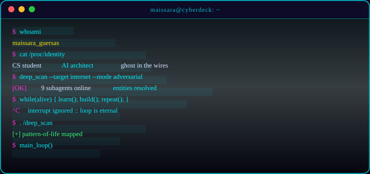

<table>
<tr>
<td width="50%"></td>
<td width="50%"></td>
</tr>
</table>


<!-- ═══════════════ 02 · STACK ═══════════════ -->

<!-- EDIT ME: swap the icon ids for what you actually use → https://skillicons.dev -->
<b>⚡ CORE SYSTEMS &amp; LANGUAGES</b> 

  

<b>🧠 DATA · ML · ASYNC CORE</b> 
 
  
  

<b>🛡️ SECURITY · OSINT · AUTOMATION</b> 
   
  

<b>🌐 WEB3 · BLOCKCHAIN · APIs</b> 
    
  

<b>💻 ENVIRONMENT &amp; TOOLS</b> 

  


<!-- ═══════════════ 03 · PROJECTS ═══════════════ -->

<a href="https://github.com/maissaraguersas-dev/deep-osint"></a>
<a href="https://github.com/maissaraguersas-dev/smis"></a>
<a href="https://github.com/maissaraguersas-dev/the-eye-memecoin"></a>
<a href="https://github.com/maissaraguersas-dev/one-step-ahead"></a>

 

<b>📡 LIVE TELEMETRY // PIN FEED</b>  

 

<!-- ═══════════════ 04 · CHAIN VISION ═══════════════ -->


<!-- ═══════════════ 05 · ACTIVITY ═══════════════ -->

  

 

<b>🐍 THE SNAKE // CONSUMING THE CONTRIBUTION GRID</b> 

<!-- ═══════════════ 06 · MANIFESTO ═══════════════ -->


<!--
  🎬 VIDEO SLOT (see SETUP.md): on github.com, edit this file and drag-drop an .mp4 here.
  GitHub uploads it and pastes a URL on its own line, which renders as a video player.
  🎞️ GIF / ANIME SLOT: drop a .gif into /assets, then:
  
-->

 

<i>"The sky above the port was the color of television, tuned to a dead channel."</i> 
— William Gibson · Neuromancer
  
<i>"Wake up, Neo… The Matrix has you."</i> 
— Morpheus

<!-- ═══════════════ 07 · CONTACT ═══════════════ -->

<!-- Want more buttons later? Copy a line above and use assets/btn-linkedin.svg, btn-x.svg or btn-discord.svg with your own link. -->

  

<b>OPEN CHANNEL FOR</b> 

 


